# Evidence

Screenshots of every screen state, captured against the running app
(`./dev.sh`) with the default 60-interview seed.

## List view

| | State | What it shows |
|---|---|---|
| 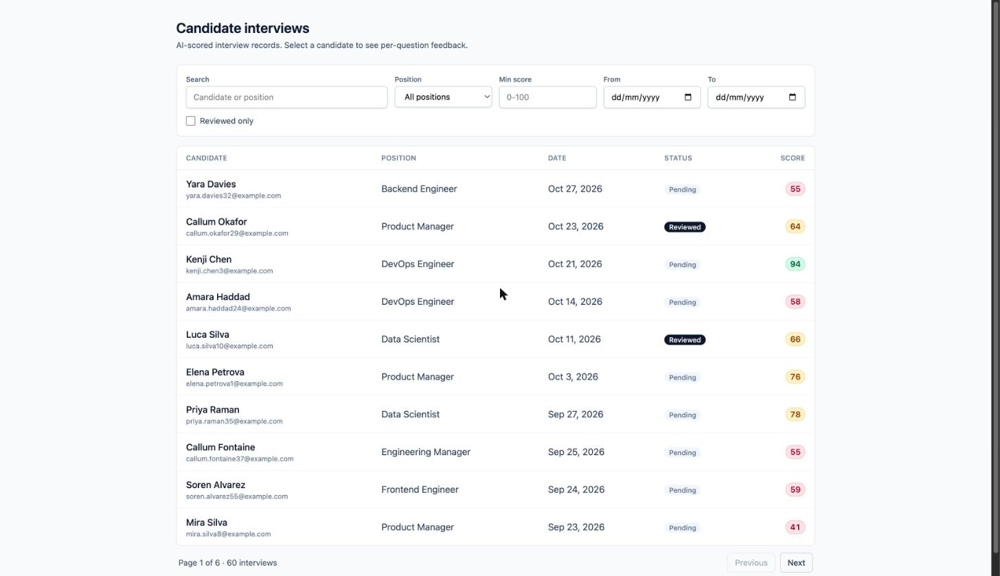 | **[Default](01-list-default.jpg)** | 60 interviews, newest first, 10 per page. Score badges colour by band (green ≥80, amber 60–79, red <60) using the band the API sends. |
| 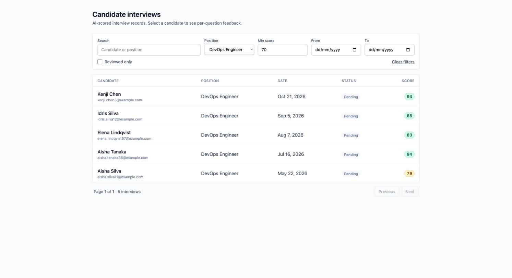 | **[Filtered](02-list-filtered-position-and-score.jpg)** | Position + min score combined with AND. 5 results, pagination collapsed to one page, Clear filters appears. |
| 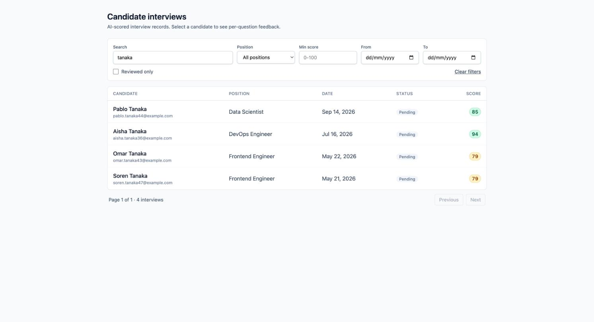 | **[Search](03-list-search.jpg)** | Substring search over candidate name and position, debounced 300ms. |
| 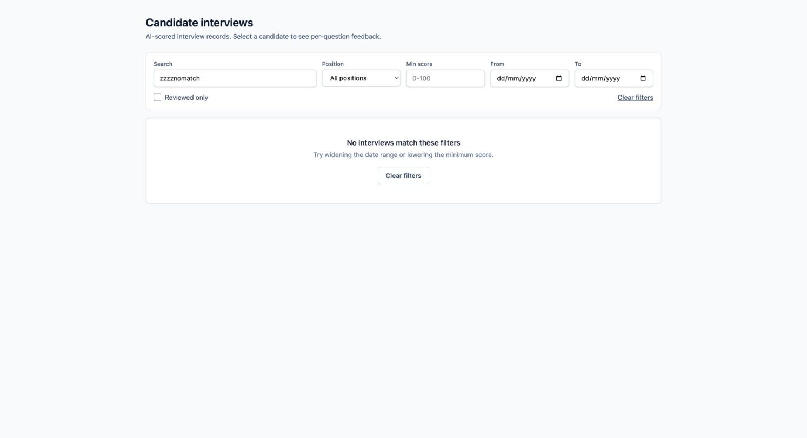 | **[Empty](04-list-empty-no-matches.jpg)** | Filters exclude everything. Distinct from an error, with a Clear filters action. |
| 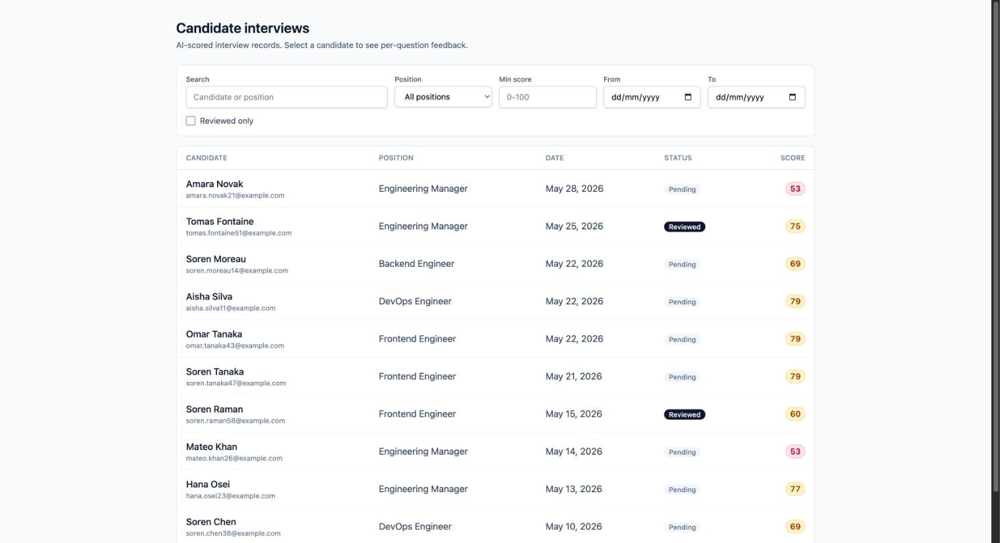 | **[Last page](05-list-last-page.jpg)** | Page 6 of 6. Ordering holds across pages; Next is disabled at the boundary. |

## Detail view

| | State | What it shows |
|---|---|---|
| 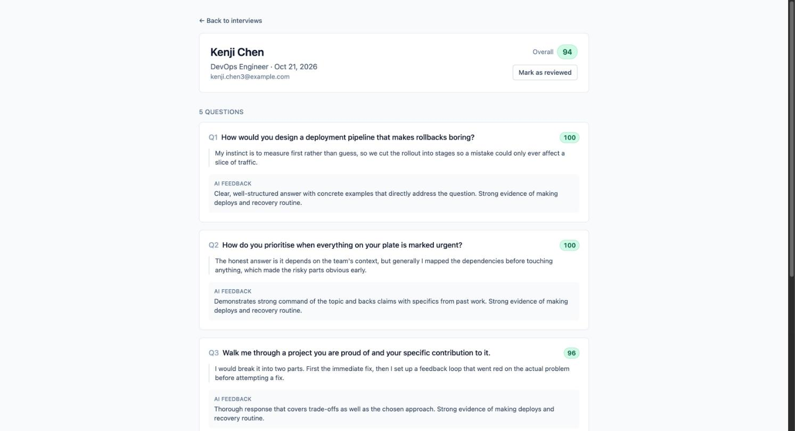 | **[Unreviewed](06-detail-unreviewed.jpg)** | Candidate header, overall score, per-question score, response and AI feedback. Feedback names the role requirement ("Strong evidence of making deploys and recovery routine"). |
| 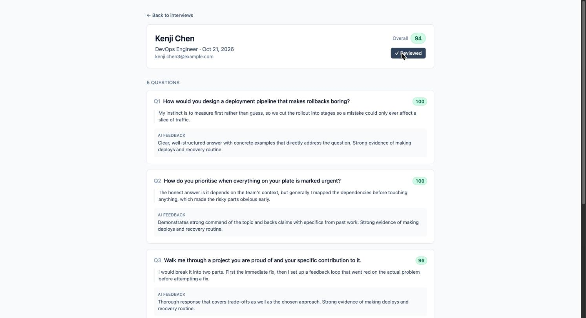 | **[Reviewed](07-detail-reviewed.jpg)** | After the toggle. Persisted server-side via `PATCH`, visible in the list afterwards. |

## Error states

| | State | What it shows |
|---|---|---|
| 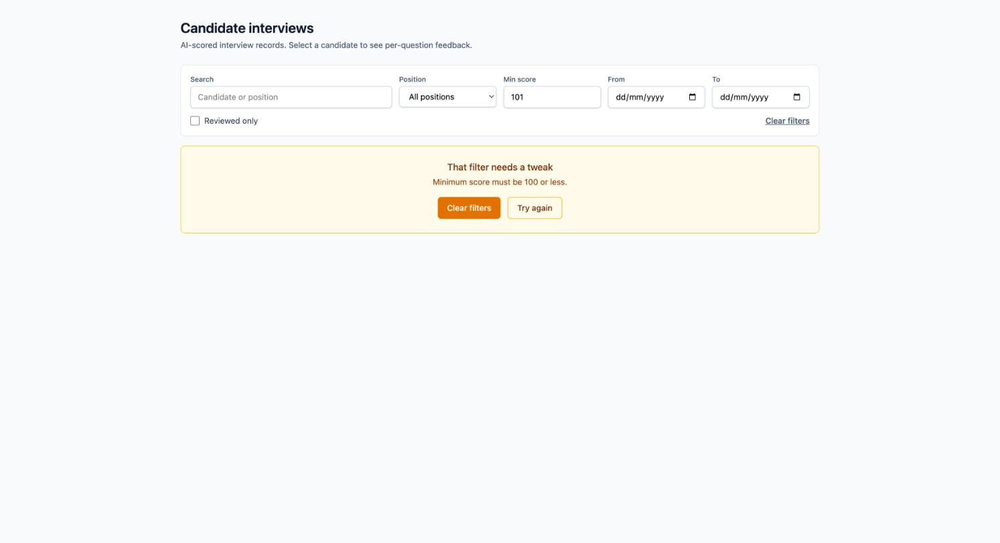 | **[Invalid filter](08-error-invalid-filter.jpg)** | `?min_score=101`. Amber, "That filter needs a tweak", with the readable API message and a Clear filters escape. Not styled as a failure. |
| 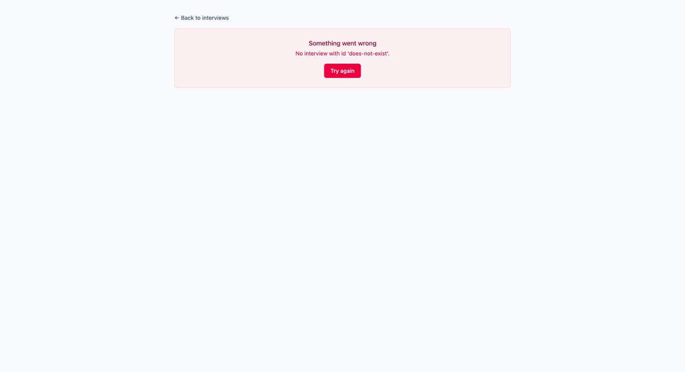 | **[Unknown interview](09-error-detail-404.jpg)** | Red, because a missing record is a genuine failure rather than a filter slip. |
| 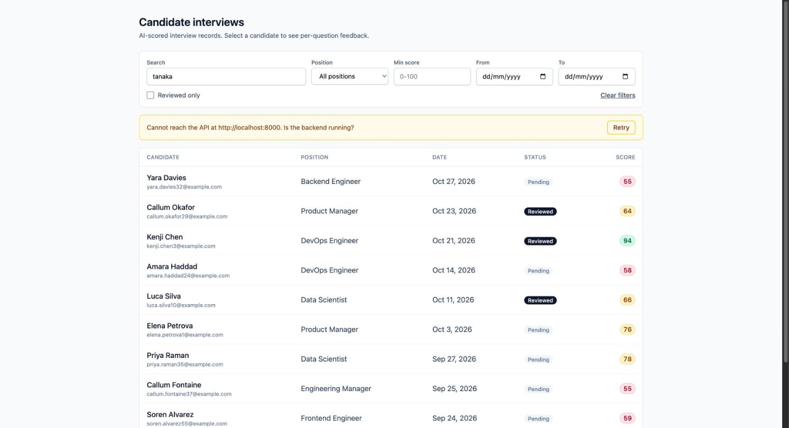 | **[API lost mid-session](10-error-banner-keeps-results.jpg)** | The backend was stopped, then a refetch triggered. The last good results stay on screen with the message above them. |
| 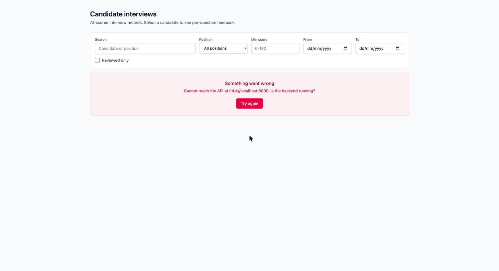 | **[API down on first load](11-error-api-down-cold-load.jpg)** | Nothing to keep, so the error takes the page. No Clear filters offered, since no filters are set. |

## API docs

| | State | What it shows |
|---|---|---|
| 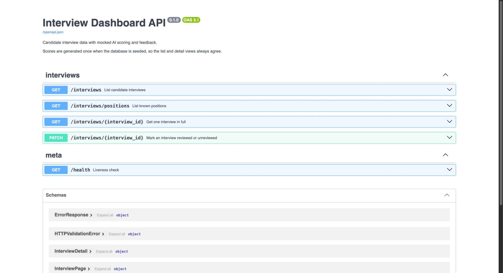 | **[Swagger](12-swagger-docs.jpg)** | All five endpoints with summaries, plus the response schemas. |

## Mobile (390px)

| | State | What it shows |
|---|---|---|
| 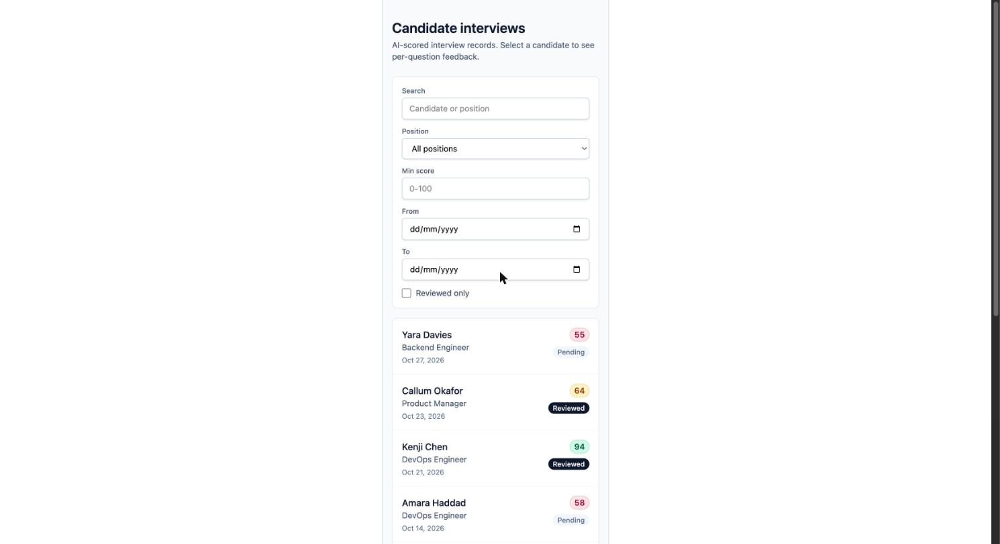 | **[List](13-mobile-list-390px.jpg)** | Table becomes stacked cards; the filter grid collapses to one column. No sideways scroll. |
| 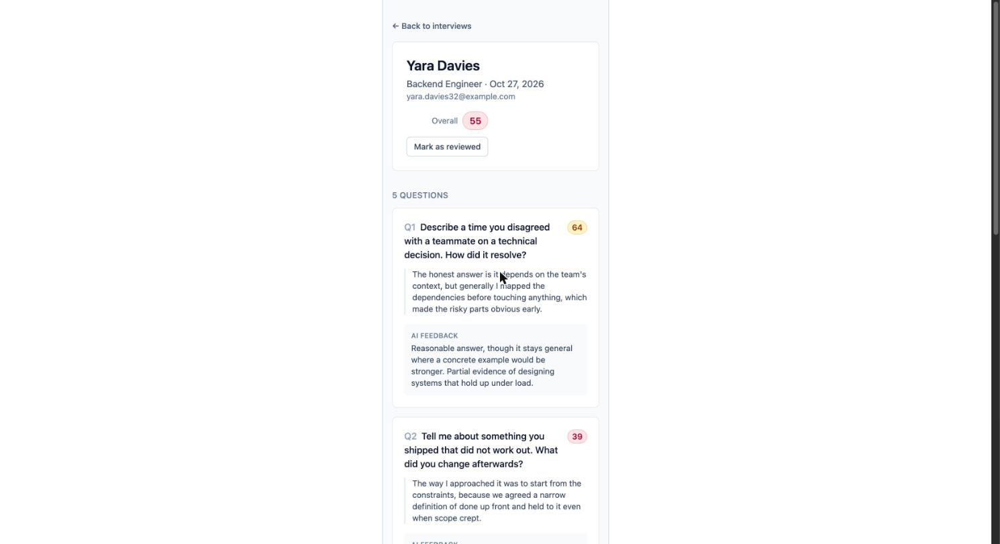 | **[Detail](14-mobile-detail-390px.jpg)** | Header stacks, score badges keep their size beside wrapped question text. |

## How these were captured

These are screenshots of the live app in Chrome, not mock-ups. The mobile pair was
rendered at 390px by applying the below-`md` rules directly, since the browser
window could not be resized below 1728px in this environment; the breakpoint
classes themselves are pinned by tests in
`frontend/src/components/InterviewTable.test.tsx`.
